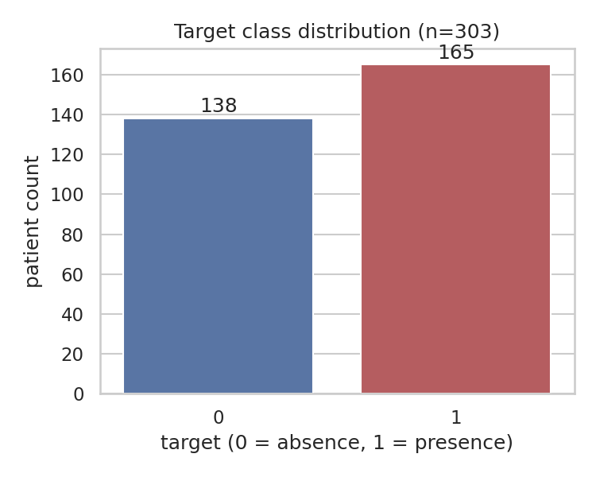
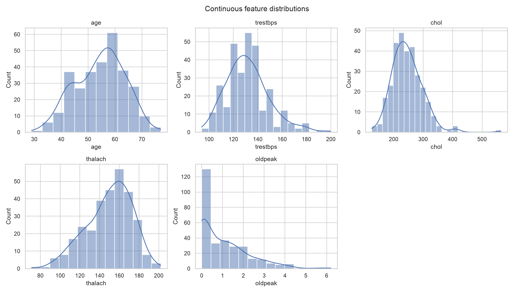
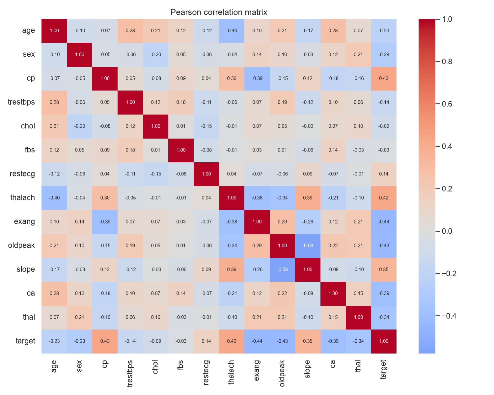
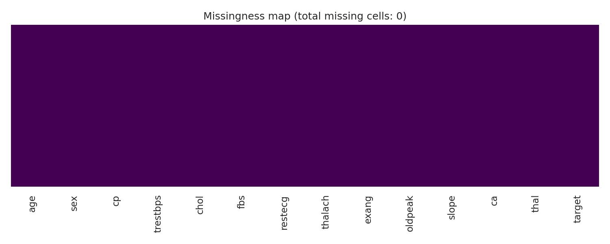
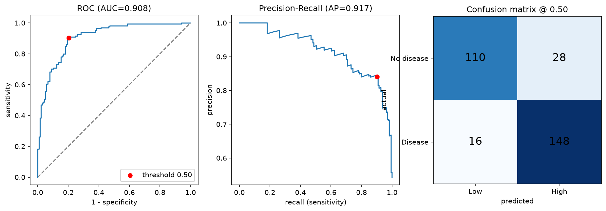

# HeartGuard AI — Multi-Model Diagnosis Support Tool

A clinical decision-support prototype built around a voting-ensemble classifier for the UCI Heart Disease dataset. The project follows the PRD for a 12-week advanced data science exercise and delivers the end-to-end workflow from data validation and EDA through model training, threshold selection, API serving, and a minimal React frontend.

## Live demo

- Deployed app: [HeartDisease Voting Ensemble](https://heart-disease-voting-ensemble.vercel.app/)

## Project status

This repository is complete for the implemented scope only. The features below are the ones actually reflected in the current code and artifacts:

- Data ingestion and schema validation
- Exploratory data analysis and dataset diagnostics
- Leakage-safe preprocessing and baseline models
- Voting classifier training with hard/soft voting strategies
- Nested cross-validation tuning and threshold selection
- Model evaluation with sensitivity, specificity, precision, F1, and ROC AUC
- FastAPI backend for scoring and metadata
- React frontend for clinician-facing risk input and output
- Dockerized backend runtime and project documentation
- Model card and project status documentation

The exact verified status and commands used are documented in [`docs/PROJECT_STATUS.md`](docs/PROJECT_STATUS.md).

## Problem statement

Clinical teams need a repeatable, data-driven signal to help prioritize patients with elevated heart-disease risk. This prototype is designed to support physician review and specialist triage, not to replace clinical judgment or act as an autonomous diagnosis system.

## Product boundary

This is an educational prototype for decision support and model-development practice. It is not a medical device and not validated for clinical deployment.

## Dataset and modeling context

- Dataset: UCI Heart Disease (Cleveland subset)
- Objective: binary classification for risk flagging
- Validation strategy: stratified 5-fold cross-validation
- Modeling approach: ensemble voting classifier with leakage-safe preprocessing
- Output: risk probability and operating threshold for high-risk flagging

## Model summary

The current model artifact is version `m1.0.0` and was selected using a nested-CV workflow with a probability threshold chosen by the rule: maximize specificity while keeping sensitivity at or above 0.90 on out-of-fold predictions.

| Metric | Value |
|---|---:|
| Threshold | 0.5000575873252479 |
| Sensitivity | 0.902 |
| Specificity | 0.797 |
| Precision | 0.841 |
| F1-score | 0.871 |
| ROC AUC | 0.908 |

The artifact and associated metadata are stored in `training/artifacts/models/` and summarized in [`docs/MODEL_CARD.md`](docs/MODEL_CARD.md).

## Model-produced visuals and what they represent

The project generates several figures during data exploration and evaluation. These images help explain the dataset and model behavior without claiming clinical certainty.

### 1. Target distribution



This plot shows whether the dataset is balanced or skewed between the disease and non-disease classes. In this project, the target is close to balanced, which matters because it supports more reliable threshold and metric interpretation during cross-validation.

### 2. Feature distributions



This image summarizes the spread of the continuous clinical variables, such as age, blood pressure, cholesterol, and exercise-induced angina-related measures. It highlights how the inputs vary and where values are concentrated or unusually extreme.

### 3. Correlation heatmap



This heatmap shows how strongly features relate to each other and to the target. It helps identify which variables are most associated with the outcome, such as exercise-induced angina and chest pain type, while keeping in mind that correlation does not establish causation.

### 4. Missingness and data quality heatmap



This plot highlights missing or out-of-range coded values. In this dataset, it is especially useful for identifying the recoded missing values in fields such as `ca` and `thal`, which were treated as data-quality issues rather than silently ignored.

### 5. Evaluation curves



This figure summarizes model discrimination and calibration behavior during evaluation. It is used to inspect how well the classifier separates positive and negative cases across threshold settings and to understand predictive confidence.

## What is implemented

### Training and analysis

- Data loading and validation: `training/src/data/`
- EDA and dataset diagnostics: `training/src/eda/`
- Leakage-safe preprocessing: `training/src/features/`
- Baseline and ensemble models: `training/src/models/`
- Cross-validation, tuning, threshold sweeps, and evaluation artifacts: `training/artifacts/`

### Backend

- FastAPI service: `backend/app/`
- API routes for health, model metadata, scoring, and model card
- Request validation and rate limiting
- Model loading on app startup with versioned metadata checks

### Frontend

- React + TypeScript + Vite application: `frontend/`
- Single-page dashboard for patient input and risk result display

### Documentation

- Data dictionary: [`docs/DATA_DICTIONARY.md`](docs/DATA_DICTIONARY.md)
- Project status: [`docs/PROJECT_STATUS.md`](docs/PROJECT_STATUS.md)
- Model card: [`docs/MODEL_CARD.md`](docs/MODEL_CARD.md)
- ADRs: [`docs/adr/`](docs/adr/)

## Repository structure

```text
heart-disease-voting-ensemble/
├── backend/
│   ├── app/
│   ├── Dockerfile
│   ├── requirements.txt
│   └── requirements-dev.txt
├── data/
│   ├── processed/
│   └── raw/
├── docs/
│   ├── adr/
│   ├── DATA_DICTIONARY.md
│   ├── MODEL_CARD.md
│   └── PROJECT_STATUS.md
├── frontend/
│   ├── src/
│   ├── index.html
│   ├── package.json
│   ├── tsconfig.json
│   └── vite.config.ts
├── scripts/
│   ├── download_data.py
│   └── generate_model_card.py
├── training/
│   ├── artifacts/
│   ├── src/
│   ├── tests/
│   └── requirements.txt
├── LICENSE
├── README.md
├── pyproject.toml
├── requirements-quality.txt
└── .gitignore
```

## Quick start

### Prerequisites

- Python 3.11+
- Node.js 18+ for frontend development

### 1. Set up the Python environment

```bash
python3 -m venv .venv
source .venv/bin/activate
pip install -r training/requirements.txt
```

### 2. Download the dataset

```bash
python scripts/download_data.py
```

### 3. Run training and validation steps

```bash
python -m training.src.data.ingestion
python -m training.src.data.validation
python -m training.src.eda.run_eda
python -m training.src.models.train --quick
```

The training run produces evaluation artifacts and model metadata under `training/artifacts/`.

### 4. Run the backend

```bash
cd backend
pip install -r requirements.txt
uvicorn app.main:app --reload
```

API docs are available at `http://localhost:8000/docs`.

### 5. Run the frontend

```bash
cd frontend
npm install
npm run dev
```

## Tests

Python tests are organized under `training/tests/` and backend tests under `backend/tests/`.

```bash
pytest training/tests -q
```

Frontend tests can be run with:

```bash
cd frontend
npm test
```

## Limitations and ethics

- This dataset reflects a single historical population and is not representative of all patient groups.
- The project is a prototype for research and learning, not a production clinical deployment.
- Model outputs are advisory signals only and must be reviewed by a qualified clinician.
- Calibration, drift monitoring, deployment workflow, and live operational monitoring are not part of the current production-ready scope.

## Ideal ML model README structure

A strong machine learning repository README should include the sections below. This project follows that model closely:

1. Problem and business context
2. Dataset and data provenance
3. Modeling objective and target definition
4. Solution overview and architecture
5. Training workflow and validation strategy
6. Model performance and threshold rationale
7. Limitations, ethical considerations, and risks
8. Setup and reproduction instructions
9. API or deployment details if applicable
10. Model card or governance documentation
11. Repository structure and ownership
12. Clear statement of what is complete vs. what is planned

A high-quality model README should be honest about what was measured, what remains unvalidated, and where the model is safe to use and where it is not.

## License

MIT — see [LICENSE](LICENSE).
